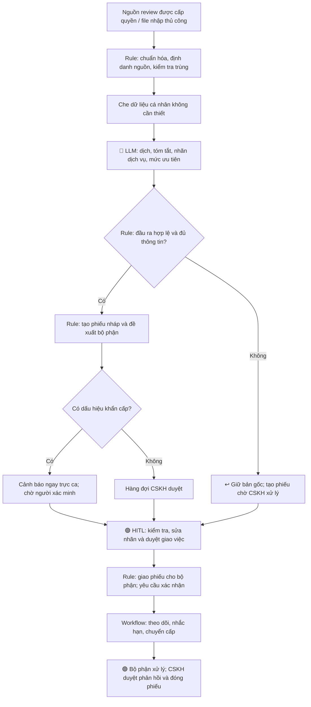

# Báo cáo phân tích sâu dự án AI — Vinpearl

**Người thực hiện:** Đỗ Minh Thanh — AI Engineer, Vin Smart Future.  
**Bài toán được chọn:** Card #4 — Tổng hợp và điều phối xử lý phàn nàn khách hàng đa ngôn ngữ, đa nền tảng.  
**Đơn vị áp dụng:** Vinpearl.  
**Nguồn nội dung:** Phase 3 (DEEP-DIVE) và Phase 5 (EVALUATE) trong `01-worksheet.md`, kế thừa lựa chọn tại `01-problem-scan.md`.

> **Trạng thái bằng chứng:** Đây là bản phân tích và đề xuất cho bài Lab. Tài liệu hiện có chưa cung cấp dữ liệu review thực tế, log thời gian xử lý, quyền tích hợp nền tảng hoặc xác nhận của stakeholders. Các thời gian, ngưỡng chất lượng, phạm vi thử nghiệm và SLA dưới đây là giả định hoặc mục tiêu đề xuất, chưa phải kết quả đo tại Vinpearl.

---

# 🏗️ Phase 3 — DEEP-DIVE (Nhóm, 85 min)

## 3.1. Current-State Workflow Mapping (25 min)

### Bối cảnh và phạm vi khảo sát

Phản hồi về Vinpearl xuất hiện trên Booking.com, Agoda và Google Maps bằng nhiều ngôn ngữ. Nhóm tập trung vào quá trình từ khi CSKH tiếp nhận một review đến khi thông tin được chuyển đến đúng bộ phận và được theo dõi xử lý.

Quy trình hiện tại dưới đây được dựng từ mô tả bài toán ở Phase 2, cần được CSKH xác nhận khi khảo sát. Công cụ và thời gian trong bảng là giả định để lập kế hoạch đo baseline.

### Quy trình hiện tại

```text
Review trên Booking.com / Agoda / Google Maps
    ↓
[1] CSKH mở từng nền tảng và thu thập phản hồi 🔴
    ↓ 🔄 Nền tảng → danh sách theo dõi của CSKH
[2] Đọc, dịch và tóm tắt nội dung 🔴
    ↓
[3] Xác định dịch vụ liên quan và mức độ khẩn cấp 🔴
    ↓
[4] Tổng hợp thông tin, chuyển cho bộ phận phụ trách 🔴
    ↓ 🔄 CSKH → Lễ tân / Buồng phòng / Nhà hàng / Kỹ thuật
[5] Bộ phận tiếp nhận; CSKH theo dõi, nhắc và cập nhật kết quả
    ↓ 🔄 Bộ phận xử lý → CSKH
CSKH kiểm tra kết quả và phản hồi khách hàng
```

| Bước | Người thực hiện và công cụ giả định | Đầu ra / Handoff | Thời gian thao tác giả định | Điểm nghẽn |
| --- | --- | --- | ---: | --- |
| 1. Thu thập review | CSKH mở từng trang quản lý hoặc danh sách review | 🔄 Review chuyển vào bảng theo dõi chung | 2 phút/review | 🔴 Chuyển nhiều nền tảng; dễ bỏ sót hoặc ghi trùng. |
| 2. Đọc và dịch | CSKH đọc bản gốc, dùng công cụ dịch khi cần | Bản dịch và tóm tắt | 4 phút/review | 🔴 Nhiều ngôn ngữ, cách diễn đạt và ngữ cảnh khác nhau. |
| 3. Gắn nhãn | CSKH xác định dịch vụ và mức độ khẩn cấp | Nhãn dịch vụ, mức ưu tiên | 3 phút/review | 🔴 Một review có thể nói về nhiều dịch vụ; phân loại thiếu nhất quán. |
| 4. Chuyển xử lý | CSKH soạn nội dung qua email, kênh nội bộ hoặc hệ thống ticket | 🔄 Phiếu yêu cầu gửi bộ phận phụ trách | 3 phút/review | 🔴 Chuyển nhầm bộ phận, thiếu ngữ cảnh hoặc chưa rõ người nhận. |
| 5. Theo dõi | CSKH kiểm tra danh sách, liên hệ bộ phận và cập nhật | 🔄 Trạng thái xử lý trả về CSKH | 3 phút/review | Theo dõi thủ công, khó phát hiện quá hạn. |

**Tổng cộng giả định = 15 phút thao tác/review**, chưa gồm thời gian từ lúc review được đăng đến khi được phát hiện, thời gian chờ bộ phận tiếp nhận và thời gian xử lý thực tế. Không sử dụng con số này như baseline đã xác minh.

### Bốn bottleneck trọng tâm

| Bottleneck | Nguyên nhân | Hệ quả cần kiểm chứng |
| --- | --- | --- |
| **Nhiều ngôn ngữ** | Phải đọc và dịch thủ công; dễ mất sắc thái hoặc ngữ cảnh. | Tăng thời gian đọc, bỏ sót chi tiết ảnh hưởng mức ưu tiên. |
| **Đa nền tảng** | Thông tin nằm ở nhiều kênh, chưa có hàng đợi tập trung. | Bỏ sót, trùng lặp và phát hiện review muộn. |
| **Gắn nhãn dịch vụ** | Review không có cấu trúc, có thể chứa nhiều vấn đề. | Phân loại thiếu nhất quán, chuyển sai hoặc thiếu bộ phận. |
| **Phối hợp giữa các bộ phận** | Giao việc, xác nhận tiếp nhận và nhắc hạn còn rời rạc. | Không rõ trách nhiệm, chậm xử lý hoặc thiếu cập nhật. |

### Kế hoạch xác lập baseline

Trong 5 ngày làm việc khảo sát đề xuất, ghi số lượng review theo kênh, ngôn ngữ và dịch vụ; đo thời gian thao tác từng bước, thời gian chờ bàn giao, tỷ lệ chuyển sai và tỷ lệ quá hạn. Thu thập lịch sử thời điểm đăng/tiếp nhận khi nguồn dữ liệu có cung cấp; trường hợp thiếu timestamp phải đánh dấu thiếu, không tự suy diễn.

CSKH và đại diện các bộ phận xác nhận sơ đồ, công cụ thực tế và cách đo trước khi dùng baseline để so sánh hiệu quả.

## 3.2. Problem Statement (6-field) & Metrics (15 min)

### Problem Statement

| Field | Nội dung chi tiết |
| --- | --- |
| **1. Actor / Operator** | Nhân viên CSKH Vinpearl thực hiện tiếp nhận, đọc dịch, phân loại và chuyển phàn nàn hằng ngày. Các bộ phận lễ tân, buồng phòng, nhà hàng, kỹ thuật và quản lý trực ca tiếp nhận công việc. Khách hàng là người chịu ảnh hưởng khi phàn nàn được xử lý chậm. |
| **2. Current Workflow** | CSKH kiểm tra Booking.com, Agoda và Google Maps; đọc/dịch review; xác định dịch vụ và mức ưu tiên; chuyển nội dung qua công cụ nội bộ; theo dõi phản hồi từ bộ phận. Workflow và công cụ cụ thể cần xác nhận qua khảo sát. |
| **3. Bottleneck** | Bốn điểm nghẽn: dịch nhiều ngôn ngữ, tổng hợp đa nền tảng, gắn nhiều nhãn dịch vụ và phối hợp giao việc. LLM phù hợp với việc hiểu nội dung; tích hợp dữ liệu và giao việc có thể thực hiện bằng Rule/Workflow. |
| **4. Business Impact** | Nhân viên mất thời gian rà soát và soạn phiếu; phàn nàn có thể bị bỏ sót, chuyển sai hoặc xử lý muộn. Nếu khảo sát xác nhận baseline 15 phút/review và pilot đạt 3 phút thao tác/review thì tiết kiệm giả định là 12 phút/review, tương đương 20 giờ cho 100 review. Chưa có dữ liệu để khẳng định mức tiết kiệm, tác động doanh thu hoặc ROI thực tế. |
| **5. Success Metric** | Mục tiêu: p95 thời gian từ tiếp nhận đến tạo phiếu nháp ≤ 3 phút; tỷ lệ gắn đúng toàn bộ bộ nhãn dịch vụ ≥ 90%; recall phàn nàn khẩn cấp ≥ 95%; precision cảnh báo khẩn cấp ≥ 80%. Đo trên tập kiểm thử có nhãn chuẩn; theo dõi thêm thời gian thao tác của nhân viên và chi phí/review. |
| **6. Operational Boundary** | Hệ thống được đọc dữ liệu từ nguồn được cấp quyền, dịch, tóm tắt, đề xuất nhãn, tạo phiếu nội bộ và nhắc hạn theo quy tắc. Trong pilot, CSKH duyệt mọi phiếu trước khi giao chính thức. Cảnh báo nghi khẩn cấp được gửi ngay đến người trực để kiểm tra. AI không tự đăng phản hồi công khai, hứa bồi thường, quyết định trách nhiệm, đóng khiếu nại hoặc thực hiện chỉ dẫn nằm trong review. Trường hợp thiếu dữ liệu, lỗi hoặc chưa rõ phải chuyển người xử lý. |

### Định nghĩa và cách đo metric

| Metric | Cách đo | Mục tiêu đề xuất |
| --- | --- | --- |
| Thời gian tạo phiếu nháp | `t_draft_created - t_ingested`; tính cả thời gian xếp hàng và retry. Báo cáo thêm tỷ lệ tạo thất bại, không loại bỏ âm thầm. | p95 ≤ 3 phút. |
| Độ chính xác nhãn dịch vụ | Số review có toàn bộ tập nhãn trùng nhãn chuẩn / tổng review được đánh giá; hỗ trợ nhiều nhãn/review. | ≥ 90%. |
| Recall phàn nàn khẩn cấp | Số review khẩn cấp được cảnh báo đúng / tổng review khẩn cấp theo nhãn chuẩn. | ≥ 95%. |
| Precision cảnh báo khẩn cấp | Số cảnh báo khẩn cấp đúng / tổng cảnh báo khẩn cấp được phát ra. | ≥ 80%, hạn chế quá tải cảnh báo. |
| Chất lượng dịch và tóm tắt | Người đánh giá đối chiếu bản gốc: không làm sai dịch vụ, vấn đề, phủ định hoặc mức độ nghiêm trọng. | ≥ 95% mẫu đạt rubric đã thống nhất. |
| Thời gian thao tác CSKH | Tổng thời gian nhân viên thực sự đọc, sửa, duyệt và giao phiếu; so sánh trước/sau trên cùng nhóm review. | Mục tiêu ban đầu ≤ 3 phút/review; phải xác minh bằng pilot. |
| Thời gian duyệt và tiếp nhận | Tách riêng thời gian chờ CSKH duyệt và chờ bộ phận nhận việc khỏi thời gian tạo nháp. | Đo riêng; SLA do vận hành phê duyệt trước pilot. |
| Chi phí xử lý | Chi phí tích hợp, LLM, vận hành và công duyệt chia số review xử lý; báo cáo cả trường hợp lỗi. | Phải thấp hơn giá trị thời gian tiết kiệm theo baseline đã đo. |

Mốc 3 phút trong Phase 2 được dùng cho **tạo phiếu nháp**, không đồng nghĩa đã giải quyết khiếu nại trong 3 phút. Độ trễ từ lúc review được đăng đến lúc nguồn dữ liệu cho phép tiếp nhận là chỉ số riêng.

### Dữ liệu kiểm thử đề xuất

Chuẩn bị tối thiểu 300 review được phép sử dụng: 100 mẫu để hoàn thiện nhãn, quy tắc và prompt; 200 mẫu kiểm thử giữ riêng, trong đó có ít nhất 50 mẫu khẩn cấp. Các ngôn ngữ ưu tiên, kênh và nhóm dịch vụ phải có đại diện; ưu tiên ban đầu tiếng Việt và tiếng Anh, các ngôn ngữ chưa được đánh giá chuyển người kiểm tra.

Hai nhân viên nghiệp vụ gắn nhãn độc lập về dịch vụ, mức ưu tiên và bộ phận phụ trách; người thứ ba giải quyết bất đồng. Chốt tiêu chí khẩn cấp trước khi gắn nhãn, ví dụ phản ánh nguy cơ an toàn hoặc sự cố đang diễn ra cần trực ca xác minh. Loại bản trùng khỏi hai tập để tránh rò rỉ dữ liệu. Mẫu giả lập chỉ dùng kiểm tra chức năng và tình huống biên, không thay thế dữ liệu thực để kết luận chất lượng vận hành.

## 3.3. Future-State Flow & AI Fit (25 min)

### AI-Fit Matrix

- [x] **Rule / State-Machine:** Tiếp nhận dữ liệu, chuẩn hóa, kiểm tra trùng, kiểm tra đầu ra, ánh xạ dịch vụ sang bộ phận, quản lý trạng thái và nhắc hạn.
- [x] **LLM Feature:** Nhận diện ngôn ngữ, dịch, tóm tắt, gắn nhãn đa dịch vụ và đề xuất mức ưu tiên từ nội dung tự do.
- [ ] **Agentic Loop:** Chưa cần trong phạm vi ban đầu. Các bước và công cụ đã xác định trước; không giao cho LLM tự chọn hành động hoặc tự truy cập các nền tảng.

| Phương án | Phần xử lý tốt | Hạn chế / Chi phí | Quyết định |
| --- | --- | --- | --- |
| **Chỉ Rule / State-Machine** | Gom kênh, chống trùng, giao việc theo bảng ánh xạ và nhắc hạn. | Khó bao phủ ngôn ngữ tự do, phủ định, châm biếm và review có nhiều vấn đề nếu chỉ dùng từ khóa. | Dùng làm baseline so sánh và lớp điều khiển workflow. |
| **Rule + LLM Feature** | Giữ quy trình cố định, bổ sung khả năng hiểu và dịch nội dung đa ngôn ngữ. | Phát sinh chi phí suy luận và duyệt; cần kiểm thử sai nhãn, dịch sai và cảnh báo giả. | **Phương án đề xuất cho pilot sau khi đủ điều kiện.** |
| **Agentic Loop** | Có thể tự lập kế hoạch và phối hợp công cụ trong tác vụ mở. | Tăng số lần gọi, độ trễ và khó kiểm soát hành động; chưa có nhu cầu cho quy trình này. | Chưa chọn; chỉ xem xét lại khi có nhu cầu được chứng minh. |

Bot theo dõi kênh là tác vụ tích hợp theo lịch hoặc sự kiện, không mặc nhiên là AI Agent. Việc có thể lấy review từ từng nền tảng phải được xác minh qua quyền truy cập và phương thức tích hợp thực tế; báo cáo không giả định cả ba nguồn đều có API khả dụng.

### Future-State Flow



Phạm vi pilot đề xuất: một cơ sở Vinpearl, tiếng Việt/Anh, một nguồn dữ liệu được xác nhận hoặc file xuất được phép sử dụng. Booking.com, Agoda và Google Maps là phạm vi mở rộng theo lộ trình; không cần tích hợp đồng thời cả ba để kiểm chứng chất lượng phân loại.

### Đầu ra LLM và điều khiển workflow

Mỗi kết quả gồm ngôn ngữ, bản dịch, tóm tắt, danh sách nhãn dịch vụ, mức ưu tiên đề xuất, trích đoạn làm bằng chứng và các thông tin còn thiếu. Hệ thống kiểm tra schema, nhãn thuộc danh mục và trích đoạn có trong bản gốc trước khi tạo phiếu. Cơ sở tiếp nhận lấy từ metadata đã xác minh, không để mô hình tự đoán.

Bảng ánh xạ được vận hành phê duyệt sẽ chuyển nhãn sang bộ phận; nhiều nhãn tạo các đầu việc dưới cùng một phiếu, có một người chịu trách nhiệm chính. Khóa định danh theo nguồn và mã review ngăn retry tạo phiếu trùng. Không gộp hai review chỉ vì nội dung tương tự; trường hợp nghi trùng được CSKH kiểm tra.

Chuỗi trạng thái đề xuất: **Tiếp nhận → Chờ duyệt → Đã giao → Đã nhận → Đang xử lý → Chờ CSKH xác nhận → Đóng**. Trường hợp lỗi có trạng thái **Chờ xử lý thủ công**. Quyền chuyển trạng thái và SLA thuộc cấu hình vận hành, không do LLM tự quyết định.

### 🟢 Human-in-the-loop (HITL)

| Điểm kiểm soát | Người chịu trách nhiệm | Cách thực hiện |
| --- | --- | --- |
| Chốt nhãn, mức ưu tiên và bảng giao việc | Trưởng nhóm CSKH, đại diện bộ phận | Phê duyệt danh mục và quy tắc trước pilot. |
| Duyệt phiếu trong pilot | Nhân viên CSKH | Đối chiếu bản gốc, bản dịch và bằng chứng; sửa trước khi giao chính thức. |
| Review nghi khẩn cấp hoặc không rõ | Quản lý trực ca / CSKH trực | Nhận cảnh báo ngay; xác minh tình trạng và quyết định hành động. Không chờ AI xác nhận chắc chắn. |
| Phản hồi khách, bồi thường và đóng phiếu | Nhân viên có thẩm quyền | Con người quyết định, duyệt và thực hiện. |

Không coi điểm tự tin do LLM tự khai là xác suất đúng. Giai đoạn đầu duyệt 100% phiếu; ngôn ngữ ngoài phạm vi, nhãn mâu thuẫn, thiếu bằng chứng hoặc thiếu metadata đều được đánh dấu cần kiểm tra. Quy tắc từ khóa khẩn cấp chỉ bổ sung cảnh báo, không được dùng để phủ định một cảnh báo của LLM.

### ↩️ Fallback và ranh giới vận hành

| Tình huống | Fallback | Người / Bộ phận tiếp nhận |
| --- | --- | --- |
| Không có quyền tích hợp, nguồn gián đoạn hoặc thiếu dữ liệu | Hiển thị thời điểm đồng bộ cuối và cảnh báo nguồn lỗi; chuyển sang kiểm tra thủ công hoặc nhập file được cấp quyền. | CSKH và đội tích hợp. |
| LLM timeout, đầu ra sai schema hoặc nhãn không hợp lệ | Retry tối đa một lần trong giới hạn thời gian; nếu vẫn lỗi, tạo phiếu thủ công kèm bản gốc. Không bỏ review. | CSKH. |
| Không rõ ngôn ngữ, dịch mâu thuẫn hoặc thiếu cơ sở tiếp nhận | Giữ trạng thái chờ xác minh, không đoán thông tin và không giao nhầm bộ phận. | CSKH, người hỗ trợ ngôn ngữ khi cần. |
| Nội dung có dấu hiệu khẩn cấp | Cảnh báo ngay trực ca bằng bản gốc và thông tin nguồn hiện có; người trực xác minh. | Quản lý trực ca. |
| API tạo phiếu lỗi | Lưu hàng đợi bền vững, dùng khóa chống trùng; báo lỗi và cung cấp nội dung để CSKH chuyển thủ công. | Đội kỹ thuật và CSKH. |
| Bộ phận không nhận việc hoặc quá hạn | Nhắc theo SLA đã cấu hình và chuyển cấp đến quản lý; không tự đánh dấu hoàn tất. | Trưởng bộ phận / trực ca. |
| Review chứa chỉ dẫn dụ AI bỏ quy tắc hoặc truy cập công cụ | Xem review là dữ liệu; không cấp công cụ cho LLM, không thực hiện chỉ dẫn bên trong nội dung. | Lớp kiểm tra và CSKH. |

Giữ bản gốc và nguồn để đối chiếu; chỉ gửi trường cần thiết đến mô hình, che thông tin cá nhân không cần cho phân loại. Dữ liệu, phiên bản prompt, kết quả sửa và lịch sử trạng thái phải được quản lý theo phân quyền nội bộ. Thời hạn lưu và môi trường xử lý dữ liệu cần được đơn vị phụ trách xác nhận trước pilot.

---

# 🏁 Phase 5 — EVALUATE (Nhóm, 20 min)

## AI Readiness Checklist

Dấu `[ ]` thể hiện điều kiện **chưa được xác minh đạt**, không khẳng định đơn vị hiện không có khả năng đáp ứng.

| Trạng thái | Checklist theo worksheet | Bằng chứng hiện có | Phần còn thiếu / Cách hoàn thành |
| --- | --- | --- | --- |
| [ ] | **Chúng tôi có sẵn dữ liệu mẫu/logs sạch để test?** | Có mô tả bài toán và mục tiêu ở Phase 2. Chưa có tập review hoặc log đính kèm để kiểm tra. | Xác nhận quyền sử dụng, chuẩn bị dữ liệu gắn nhãn và tập test độc lập; đo baseline thời gian và lỗi. |
| [ ] | **Rủi ro khi AI sai có nằm trong tầm kiểm soát qua HITL hoặc Fallback?** | Đã có thiết kế duyệt 100%, giữ bản gốc, cảnh báo trực ca và xử lý thủ công. | Chưa có kết quả thử lỗi, bỏ sót khẩn cấp, dịch sai, prompt injection hoặc lỗi tích hợp để chứng minh cơ chế hoạt động. |
| [ ] | **Stakeholders sẵn sàng thay đổi quy trình làm việc cũ?** | Đã xác định các vai trò CSKH, trực ca và bộ phận xử lý. | Chưa có xác nhận đầu mối, danh mục nhãn, bảng giao việc, SLA và lịch tham gia pilot. |

## Quyết định cuối cùng của nhóm trong vai Ban Giám Đốc Vin Smart Future

- [ ] **GO (Bắt đầu xây dựng Prototype):** Bắt đầu phát triển với scope hẹp.
- [x] **NOT YET (Cần tích lũy thêm dữ liệu/xác lập baseline):** Chuẩn bị dữ liệu, quyền tích hợp và xác nhận vận hành trước khi triển khai prototype có kết nối quy trình thực tế.
- [ ] **NO-GO (Không khả thi / Rule-based tốt hơn):** Hủy bỏ dự án AI này.

### Justification — Lý giải dựa trên bằng chứng kỹ thuật và chi phí

**Lý do chọn NOT YET:** Đầu vào hiện có cho phép xác định bài toán và thiết kế giải pháp, nhưng chưa đủ để chứng minh độ chính xác, tốc độ hay tính sẵn sàng vận hành. Không nên đánh dấu GO chỉ dựa trên sơ đồ và các metric mục tiêu.

**Về kỹ thuật:** Rule/Workflow xử lý được phần gom dữ liệu, chống trùng và giao việc; LLM có vai trò đề xuất cho nội dung đa ngôn ngữ và nhiều nhãn. Tuy nhiên, chưa có kết quả so sánh với baseline chỉ dùng quy tắc, kiểm thử bỏ sót phàn nàn khẩn cấp hoặc xác minh quyền lấy dữ liệu từng kênh. Agentic Loop chưa đem lại lợi ích được chứng minh trong phạm vi này.

**Về chi phí:** Ngoài chi phí LLM còn có tích hợp nguồn, gắn nhãn, duyệt phiếu, vận hành và xử lý lỗi. Chưa có sản lượng review, thời gian thực tế hoặc đơn giá để kết luận ROI. Dùng công thức sau khi có dữ liệu:

```text
Lợi ích thời gian/tháng
= Số review/tháng × Phút thao tác tiết kiệm/review ÷ 60
  × Chi phí nhân sự/giờ

Chi phí tăng thêm/tháng
= Chi phí LLM + tích hợp/bảo trì + hạ tầng + gắn nhãn/đánh giá
  + chi phí rà soát bổ sung chưa tính trong thời gian thao tác

Giá trị ròng/tháng = Lợi ích thời gian/tháng - Chi phí tăng thêm/tháng
```

Thời gian sửa và duyệt phiếu phải nằm trong phép đo thao tác sau triển khai để tránh phóng đại lợi ích; không tính trùng khoản nhân sự này vào chi phí tăng thêm. Chi phí thiết lập một lần cần được báo cáo riêng hoặc phân bổ theo kỳ đã thống nhất. Chưa quy đổi giảm khiếu nại thành doanh thu khi không có bằng chứng.

### Điều kiện chuyển sang GO

| Điều kiện cần hoàn thành | Đầu mối đề xuất | Bằng chứng để xem xét lại |
| --- | --- | --- |
| Chốt phạm vi một cơ sở, tiếng Việt/Anh và nguồn dữ liệu được phép sử dụng | CSKH, quản lý cơ sở và đội tích hợp | Xác nhận quyền truy cập, danh mục dữ liệu và phương thức lấy dữ liệu khả thi. |
| Chuẩn bị dữ liệu và baseline | CSKH và AI Engineer | Tập phát triển/test tách biệt; nhãn đã đối soát; báo cáo baseline từ khảo sát. |
| Chốt cách vận hành và trách nhiệm | Trưởng nhóm CSKH, quản lý trực ca, trưởng bộ phận | Bảng nhãn–bộ phận, người nhận cảnh báo, SLA và lịch tham gia pilot được xác nhận. |
| Xác nhận cơ chế kiểm soát và ngân sách thử nghiệm | AI Engineer, đội kỹ thuật và người phụ trách dữ liệu | Kế hoạch kiểm thử HITL/Fallback, giới hạn chi phí và cách đo metric được duyệt. |

Sau khi đủ các điều kiện trên, nhóm đánh giá lại để quyết định **GO cho prototype phạm vi hẹp**. Prototype phải kiểm thử Rule-only và Rule + LLM trên cùng tập test, bao gồm review đa ngôn ngữ, nhiều dịch vụ, phủ định, phàn nàn khẩn cấp, review trùng, dữ liệu thiếu và prompt injection.

Kết quả prototype đạt các metric tại mục 3.2, thử thành công fallback và được vận hành chấp thuận mới là cơ sở xem xét pilot thực tế. Nếu LLM không cải thiện chất lượng đủ bù chi phí và công duyệt so với Rule-only, tiếp tục tối ưu hoặc loại phần LLM; không mặc định phải triển khai AI cho toàn bộ quy trình.
